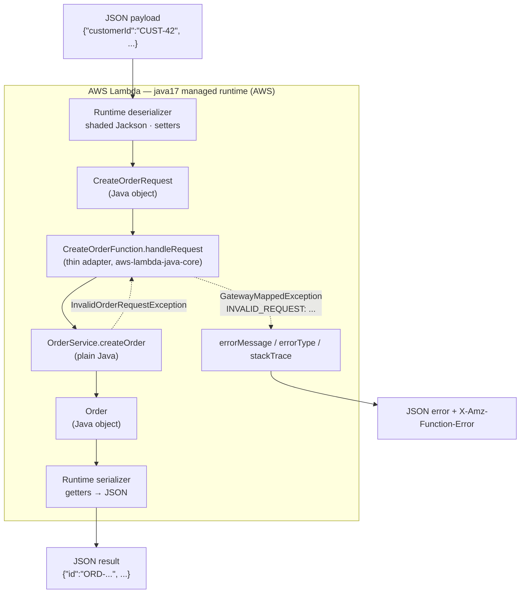
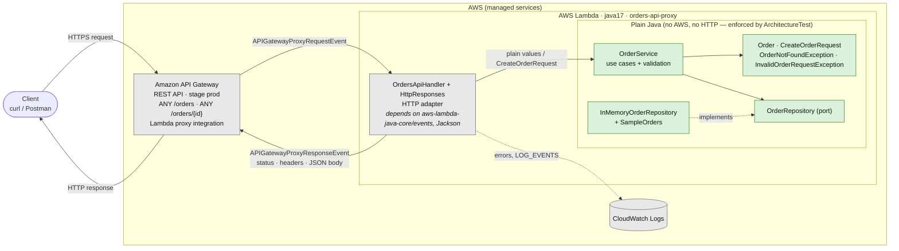
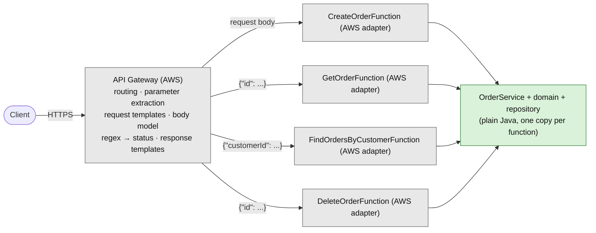

# Orders API — a serverless REST API with AWS Lambda and Amazon API Gateway

A small Order Management API in **Java 17 + Maven**, exposed twice over the same JAR so the two styles
can be compared:

* **Architecture A**: API Gateway **non-proxy integration with mapping templates**. One Lambda per operation.
  API Gateway extracts parameters, builds the Lambda input and maps errors to status codes.
* **Architecture B**: **Lambda proxy integration**. One Lambda with a thin **HTTP adapter** in Java.

The business logic (`OrderService`) is the same plain-Java code in both, and a test enforces that it never
depends on AWS, HTTP or JSON.

> **Verification status.** Everything under `mvn test` runs locally (84 tests) and the CloudFormation template
> passes `cfn-lint`. Nothing has been deployed to AWS from this repo yet: outputs shown as *expected*
> below come from the local tests and still need to be captured from the deployed stack (see [Demo](#16-demo-checklist)).

---

## Contents

1. [Quick start](#1-quick-start)
2. [Repository layout](#2-repository-layout)
3. [API contract (designed first)](#3-api-contract-designed-first)
4. [Design questions](#4-design-questions)
5. [Part I — plain Java application · Checkpoint 1](#5-part-i--plain-java-application)
6. [Part II — Lambda and JSON ↔ Java · Checkpoint 2](#6-part-ii--the-function-on-aws-lambda)
7. [Parts III–IV — Architecture A: mapping templates · Checkpoint 3](#7-parts-iiiiv--architecture-a-api-gateway-mapping-templates)
8. [Part V — Architecture B: proxy integration + HTTP adapter](#8-part-v--architecture-b-lambda-proxy-integration)
9. [Comparing the two architectures](#9-comparing-the-two-architectures)
10. [Unexpected internal errors](#10-unexpected-internal-errors)
11. [In-memory data on Lambda](#11-in-memory-data-on-lambda)
12. [Final architecture diagram](#12-final-architecture-diagram)
13. [Example requests and responses](#13-example-requests-and-responses)
14. [AI-assisted development and critique of the agent](#14-ai-assisted-development)
15. [Final challenge — DELETE /orders/{id}](#15-final-challenge--delete-ordersid)
16. [Demo checklist](#16-demo-checklist)

---

## 1. Quick start

Prerequisites: JDK 17+ (built with `--release 17`), Maven 3.9+, and for deployment the AWS CLI v2 with
credentials, plus a Bash shell (Git Bash works on Windows).

```bash
mvn test
```

```bash
mvn package
```

```bash
bash scripts/deploy.sh
```

```bash
bash scripts/invoke-lambda.sh
```

```bash
bash scripts/smoke-test.sh proxy
```

```bash
bash scripts/smoke-test.sh mapping
```

```bash
bash scripts/teardown.sh --bucket
```

* `mvn package` produces **`target/orders-api.jar`** (shaded, ready for Lambda).
* `deploy.sh` creates an S3 bucket for the JAR, deploys `infra/template.yaml` as stack `orders-api` and prints
  both base URLs. Override with `STACK_NAME`, `AWS_REGION`, `ARTIFACT_BUCKET`.
* `invoke-lambda.sh` is Part II: invokes the Lambda directly with the JSON files in `events/direct/`.
* `smoke-test.sh` calls every documented case with `curl -i` (status line, headers, body).

## 2. Repository layout

```
.
├── pom.xml
├── infra/template.yaml          # CloudFormation: 4 Lambdas, 2 REST APIs (A and B), IAM, permissions
├── docs/api-gateway-console.md  # the same API Gateway setup as manual console steps
├── events/
│   ├── direct/                  # payloads for invoking Lambdas directly (Part II, Architecture A)
│   └── proxy/                   # example API Gateway proxy events (Part V)
├── scripts/                     # deploy, invoke, smoke-test, teardown
└── src/
    ├── main/java/com/workshop/orders/
    │   ├── domain/              # Order, CreateOrderRequest, domain exceptions        (plain Java)
    │   ├── application/         # OrderService (use cases), OrderRepository (port)    (plain Java)
    │   ├── persistence/         # InMemoryOrderRepository, SampleOrders               (plain Java)
    │   ├── OrdersApp.java       # composition root                                    (plain Java)
    │   └── lambda/
    │       ├── ErrorCode.java   # error codes shared by both adapters
    │       ├── direct/          # Architecture A handlers (AWS: aws-lambda-java-core)
    │       └── proxy/           # Architecture B HTTP adapter (AWS: core + events, Jackson)
    └── test/java/...            # JUnit 5: service, adapters, runtime serialization, VTL, architecture
```

## 3. API contract (designed first)

Resource: **order** (`/orders/{id}`), inside the collection **orders** (`/orders`).

```json
{ "id": "ORD-001", "customerId": "CUST-42", "product": "MacBook Air", "quantity": 1 }
```

| | Create an order | Retrieve an order | Find a customer's orders | Delete an order |
|---|---|---|---|---|
| Method | `POST` | `GET` | `GET` | `DELETE` |
| URL | `/orders` | `/orders/{id}` | `/orders?customerId={customerId}` | `/orders/{id}` |
| Path params | – | `id` | – | `id` |
| Query params | – | – | `customerId` (required) | – |
| Request body | `{"customerId": string, "product": string, "quantity": integer}` | – | – | – |
| Success | **201 Created**, body = created order, header `Location: <path>/orders/{id}` | **200 OK**, body = order | **200 OK**, body = JSON array of orders (`[]` if none) | **204 No Content**, no body |
| Errors | **400** `INVALID_REQUEST` (missing/blank field, `quantity < 1`, wrong types, malformed JSON) · **500** | **404** `ORDER_NOT_FOUND` · **500** | **400** `INVALID_REQUEST` (no/blank `customerId`) · **500** | **404** `ORDER_NOT_FOUND` · **500** |

Validation rules (owned by `OrderService`): `customerId` and `product` are required and non-blank (trimmed);
`quantity` is required and ≥ 1. The server assigns `id` (`ORD-` + 8 hex chars); an `id` sent by the client is ignored.

**Error document** (every non-2xx response, both architectures):

```json
{ "error": "ORDER_NOT_FOUND", "message": "Order ORD-999 does not exist" }
```

| `error` | Status | Meaning |
|---|---|---|
| `INVALID_REQUEST` | 400 | The request breaks the contract; `message` lists **every** violation, separated by `; ` |
| `ORDER_NOT_FOUND` | 404 | The order does not exist |
| `ROUTE_NOT_FOUND` | 404 | No such resource (gateway response) |
| `METHOD_NOT_ALLOWED` | 405 | Resource exists, method not supported (B only; carries an `Allow` header) |
| `INTERNAL_ERROR` | 500 | Unexpected failure; `message` carries a request id for log correlation, never internals |

Predefined data in every fresh execution environment (`SampleOrders`):
`ORD-001` (CUST-42, MacBook Air, 1), `ORD-002` (CUST-42, USB-C Hub, 2), `ORD-42` (CUST-7, Keyboard, 2).
`CUST-100` deliberately has no orders.

## 4. Design questions

**What are the resources in your API?**
One resource type, the *order*, addressed as `/orders/{id}`, and the *orders collection* `/orders`, which is
where new orders are created and which can be filtered. Customers are referenced by id, not exposed as a resource.

**Why `/orders/{id}` to retrieve a particular order?**
The id *identifies* the resource, so it belongs in the path: the URL is the order's stable address. The same
URL then serves every operation on that order (`GET`, later `DELETE`, maybe `PUT`), it is what `Location`
points to after creation, and it is cacheable. `/getOrder?id=` would put a verb in the URL and make the order
not addressable.

**Why is `customerId` a query parameter in the search?**
It does not identify a resource; it *filters* the orders collection. The result is still "orders", just a
subset, and filters compose (`?customerId=X&product=Y` later) without inventing new resource paths. A path
such as `/customers/{id}/orders` would be reasonable too, but it implies customers are a resource of this API, which they are not.

**What should `POST /orders` return on success?**
`201 Created`, the full created order (including the server-assigned `id`) as the body, and a `Location` header
with the URL of the new resource. Returning the body saves the client a follow-up `GET`.

**What should the API return when an order does not exist?**
`404 Not Found` with the error document (`ORDER_NOT_FOUND`, "Order ORD-999 does not exist"). Not `200` with
`null`, and not `400` (the request is well formed; the resource just isn't there). A *search* that finds
nothing is different: the collection exists, so it is `200` with `[]`.

**What information should an error response contain?**
A stable machine-readable code (`error`) that clients can branch on, a human-readable `message` that says what
is wrong (for validation: all violations at once), and the HTTP status carrying the class of error. It must
**not** contain stack traces, class names or infrastructure details; for 500s it carries a request id instead,
so support can find the log entry.

## 5. Part I — plain Java application

`OrderService` (in `application/`) implements the use cases with plain objects:

```java
Order createOrder(CreateOrderRequest request);    // throws InvalidOrderRequestException
Order getOrder(String id);                        // throws OrderNotFoundException / InvalidOrderRequestException
List<Order> getOrdersByCustomer(String customerId);
void deleteOrder(String id);                      // throws OrderNotFoundException (added in Part 17)
```

Failures are **domain exceptions**, not status codes. Storage is behind the `OrderRepository` port, implemented
by `InMemoryOrderRepository`. The id generator is injected so tests are deterministic.

Tests (`OrderServiceTest`, 26 cases): valid creation, retrieval of an existing order, missing order, search by
customer (in creation order), empty search, invalid input (blank fields, missing fields, every violation listed,
`quantity` 0 / negative, `null` request), invalid input is not stored, and deletion (existing, missing, twice, blank id, others untouched).

### Checkpoint 1

| Question | Answer |
|---|---|
| Can the functionality be tested without AWS? | Yes. `mvn test` needs no AWS account, network or emulator. |
| Does it require a web server? | No. Nothing listens on a port; Lambda calls a method. |
| Does it require Spring Boot? | No. No framework at all, only the JDK (plus the AWS/Jackson libraries in the adapters). |
| What does the JAR contain? | `target/orders-api.jar` (≈3.4 MB, 1,681 classes) is a *shaded* JAR: our 20 classes plus Jackson, `aws-lambda-java-core`, `aws-lambda-java-events` and `joda-time` (a dependency of the events library). `original-orders-api.jar` (≈26 KB) is our classes alone. No server, no `Main`. |
| Which parts know about HTTP? | At this checkpoint: none. In the final code only `lambda/proxy` (the HTTP adapter). `lambda/direct` knows the error-code prefixes that API Gateway matches, but not status codes. `ArchitectureTest` fails the build if `domain`, `application` or `persistence` import AWS, Jackson or the adapters. |

## 6. Part II — the function on AWS Lambda

`CreateOrderFunction implements RequestHandler<CreateOrderRequest, Order>` wraps `OrderService.createOrder`.
Nothing in the application was redesigned for Lambda. Handler string:

```
com.workshop.orders.lambda.direct.CreateOrderFunction::handleRequest
```

Invoke it directly (after `deploy.sh`):

```bash
bash scripts/invoke-lambda.sh
```

which runs, for each file in `events/direct/create-order*.json`:

```bash
aws lambda invoke --function-name orders-api-create-order --cli-binary-format raw-in-base64-out --payload file://events/direct/create-order.json target/lambda-response.json
```

| Input | Expected output |
|---|---|
| `create-order.json` `{"customerId":"CUST-42","product":"MacBook Air","quantity":1}` | `{"id":"ORD-xxxxxxxx","customerId":"CUST-42","product":"MacBook Air","quantity":1}` |
| `create-order-2.json` (has an extra `"giftWrap": true`) | created normally; `giftWrap` is silently ignored |
| `create-order-invalid.json` `{"customerId":"","quantity":0}` | `FunctionError: Unhandled` and `{"errorMessage":"INVALID_REQUEST: customerId is required; product is required; quantity must be greater than 0","errorType":"com.workshop.orders.lambda.direct.GatewayMappedException","stackTrace":[...]}` |

### Investigation: how does the Java runtime convert JSON ↔ Java?

Conclusion, checked by `LambdaRuntimeSerializationTest`, which runs **the same serializer library the runtime uses**
(`aws-lambda-java-serialization`) locally:

1. The Lambda service hands the runtime the invocation payload as raw bytes (JSON).
2. On cold start the runtime loads the handler class, creates **one instance** with the no-arg constructor
   (that is when `OrdersApp.createOrderService()` runs) and reads the generic types `I` and `O` of
   `RequestHandler<I, O>` through reflection.
3. It picks a deserializer for `I`:
   * `InputStream` (`RequestStreamHandler`): no conversion, you get the bytes.
   * A known AWS event class (e.g. `APIGatewayProxyRequestEvent`): `LambdaEventSerializers`, Jackson plus
     mix-ins that map AWS's field names onto the event classes.
   * Anything else (our POJOs): `JacksonFactory`, a **shaded copy of Jackson** (`com.amazonaws.lambda.thirdparty.com.fasterxml.jackson`),
     so it neither sees nor conflicts with the Jackson in our JAR, and ignores our Jackson annotations.
4. Behaviour of that POJO mapper (each line is a test):
   * properties are bound through **setters** of a class with a **no-arg constructor**;
   * **unknown JSON properties are ignored**, missing ones stay `null` (why `quantity` is an `Integer`);
   * numeric strings are coerced (`"2"` → `2`), non-numeric strings fail;
   * classes with only an all-args constructor **cannot** be input; **records can** (I first assumed they could not; the test proved otherwise);
   * malformed JSON fails **before the handler runs**, so it reaches the caller as a runtime error, not our `INVALID_REQUEST`;
   * the return value is written from **getters**; a `List` becomes a JSON array.
5. If the handler throws, the runtime returns `{"errorMessage", "errorType", "stackTrace"}` and marks the
   invocation with `X-Amz-Function-Error`. Architecture A relies on that `errorMessage`.

To confirm on the deployed Lambda: the second input shows unknown fields are ignored, the third shows the error shape.

### Checkpoint 2: what happens on a direct invocation



## 7. Parts III–IV — Architecture A: API Gateway mapping templates

```
Client ──HTTP──▶ API Gateway (REST API "orders-api-mapping") ──▶ one Lambda per operation ──▶ OrderService
```

| Route | Lambda input built by the request template | Lambda | Response mapping |
|---|---|---|---|
| `POST /orders` | body passed through: `$input.json('$')` | `orders-api-create-order` | default → **201** + `Location`; `^INVALID_REQUEST: ` → 400; anything else → 500 |
| `GET /orders/{id}` | `{"id": "<path id>"}` | `orders-api-get-order` | default → **200**; `^ORDER_NOT_FOUND: ` → 404; `^INVALID_REQUEST: ` → 400; else → 500 |
| `GET /orders?customerId=` | `{"customerId": "<query value or empty>"}` | `orders-api-find-orders-by-customer` | default → **200**; `^INVALID_REQUEST: ` → 400; else → 500 |
| `DELETE /orders/{id}` | `{"id": "<path id>"}` | `orders-api-delete-order` | default → **204** (empty body template, the function returns `null`); `^ORDER_NOT_FOUND: ` → 404; `^INVALID_REQUEST: ` → 400; else → 500 |

The configuration lives in `infra/template.yaml` (`MappingApi` → `Body`, a Swagger 2.0 document with
`x-amazon-apigateway-integration` extensions). Console steps: [docs/api-gateway-console.md](docs/api-gateway-console.md).

How errors become status codes without Java knowing any status code: the handler wraps domain exceptions in
`GatewayMappedException`, whose message is `ERROR_CODE: message` (e.g. `ORDER_NOT_FOUND: Order ORD-999 does not exist`).
API Gateway matches the integration responses' regexes against `errorMessage`, picks the status, and a response
template strips the prefix into the error document. The 500 pattern is a negative lookahead
(`^(?!INVALID_REQUEST: |ORDER_NOT_FOUND: )[\s\S]+`) so that **every** other error, including Lambda timeouts and
runtime JSON-parsing failures, becomes 500. Without it, an unmatched error falls back to the *default*
response and the client would get `201`/`200` with an error body.

How it is tested without deploying (both are approximations; the deployed API is the real test):

* `DirectFunctionsTest` reads the selection patterns **from `template.yaml`** and asserts that each Java
  error message matches exactly one of them, with the expected status, and that **every** operation has the 500 catch-all.
  This catches drift between the Java prefixes and the YAML regexes.
* `MappingTemplateTest` renders the actual VTL templates from `template.yaml` with Velocity 1.7 and stand-ins
  for `$input`, `$util`, `$context`. This caught the `$util.escapeJavaScript` trap: it turns `'` into `\'`,
  which is **invalid JSON**, so templates add `.replaceAll("\\'", "'")`.

The POST body's **shape** (JSON object, `quantity` integer, strings) is checked by an API Gateway model and
request validator, so malformed JSON is a 400 from the gateway (`BAD_REQUEST_BODY` gateway response) instead of a
runtime parsing error (which would be a 500). **Business rules** stay in Java.

### Checkpoint 3: what API Gateway is responsible for in Architecture A

| Responsibility | Where in A |
|---|---|
| Routing (resource + method → function) | `paths` in the API definition |
| Extracting the path parameter | request template, `$input.params().path.get('id')` |
| Extracting the query parameter | request template, `$input.params().querystring.get('customerId')` |
| Transforming the request into the Lambda input | request templates (and JSON escaping) |
| Validating body shape / content type | model + request validator; passthrough `never` → 415 for other content types |
| Choosing status codes | integration responses (regex on `errorMessage`) |
| Mapping errors to the error document | integration response templates; gateway responses for 400/404/5xx it generates itself |
| Response headers (`Location`) | `$context.responseOverride.header.Location` in the 201 template |
| Hiding internal errors | the 500 template ignores the Lambda message and emits a request id |

**Advantages**

* The Java functions are tiny and contain no HTTP at all; each has a precise typed input (`OrderIdInput`, `CustomerOrdersQuery`).
* Malformed requests are rejected before a Lambda is invoked (cheaper, and the function never sees garbage).
* The HTTP contract is declared in one document (the OpenAPI/Swagger body) that can be exported, reviewed and versioned.
* One function per operation: separate scaling, timeouts, IAM permissions and deployments per operation.
* The backend can change shape without changing the public HTTP contract (the template absorbs the difference).

**Disadvantages**

* Behaviour is split across **two languages** (Java and VTL) joined by a **string contract**
  (`ORDER_NOT_FOUND: ` prefix ↔ regex) that no compiler checks. We had to write a test that parses YAML to keep them in sync.
* VTL has subtle pitfalls (escaping, null handling, `#set` with null) and cannot be unit-tested with real fidelity.
* Lots of near-duplicate configuration: the 400/500 mappings are copied on every method; adding a method touches many places.
* Easy to get wrong silently: an unmatched error defaults to a success status.
* API changes require redeploying the API stage; CloudFormation does not even do this automatically when the `Body` changes (`deploy.sh` forces it).
* Debugging needs API Gateway execution logs; the Java tests cannot show what a client will actually receive.
* Separate functions mean separate in-memory states (see [§11](#11-in-memory-data-on-lambda)) and four cold starts.

## 8. Part V — Architecture B: Lambda proxy integration

```
Client ──HTTP──▶ API Gateway (REST API "orders-api-proxy", ANY /orders, ANY /orders/{id})
                    ──whole request as an event──▶ OrdersApiHandler (HTTP adapter) ──▶ OrderService
```

API Gateway configuration is just two resources with an `ANY` method each, `type: aws_proxy`, pointing to
`orders-api-proxy`. No templates, no integration responses.

### Where the request data appears in the proxy event

Example events: [`events/proxy/get-order.json`](events/proxy/get-order.json), [`find-orders.json`](events/proxy/find-orders.json),
[`create-order.json`](events/proxy/create-order.json), [`delete-order.json`](events/proxy/delete-order.json). They follow the REST API (payload v1.0) format; to capture a
real one, set `LOG_EVENTS=true` on the function and read CloudWatch Logs.

| Information | Field(s) in the event |
|---|---|
| HTTP method | `httpMethod` (also `requestContext.httpMethod`) |
| Path | `path` (`/orders/ORD-42`, without stage); `resource` is the matched template (`/orders/{id}`); `requestContext.path` includes the stage (`/prod/orders/ORD-42`) |
| Path parameters | `pathParameters` → `{"id": "ORD-42"}` (`null` when the route has none) |
| Query parameters | `queryStringParameters` (one value per name) and `multiValueQueryStringParameters` (all values); `null` when absent |
| Headers | `headers` (one value per name) and `multiValueHeaders` |
| Request body | `body`, **a string** (the JSON is *not* parsed), plus `isBase64Encoded` for binary payloads |

### The HTTP adapter

`OrdersApiHandler implements RequestHandler<APIGatewayProxyRequestEvent, APIGatewayProxyResponseEvent>`:

1. routes on `resource` + `httpMethod` (unknown method on a known resource → 405 with `Allow`);
2. extracts `pathParameters.id`, `queryStringParameters.customerId`, decodes and parses `body` with a strict
   Jackson mapper (`quantity: 1.5` or `"2"` → 400, not silently coerced; extra fields ignored);
3. calls `OrderService` with plain values;
4. maps the outcome to HTTP: result → 200/201, completed delete → 204 (no body), `InvalidOrderRequestException` → 400,
   `OrderNotFoundException` → 404, anything else → 500 (`HttpResponses` builds status, headers and JSON body).

**Location header**: yes, after `201 Created` the response carries `Location` with the new order's URL, built
from `requestContext.path` (`/prod/orders/ORD-43`) so it includes the stage on the default endpoint.

`OrdersApiHandlerTest` (23 cases) drives the handler with the files in `events/proxy/`, deserialized by the
runtime's own event serializer, and covers 200, 201 + Location, 400 (rules, malformed JSON, wrong types, no body,
no `customerId`), 404, 405, 500, base64 bodies, and DELETE (204 without body, 404 for missing or already deleted).

## 9. Comparing the two architectures

Sizes below are non-blank, non-comment lines in this repo.

| Question | Architecture A (mapping) | Architecture B (proxy) |
|---|---|---|
| **More API Gateway configuration?** | **A**: ~229 lines (templates, method + integration responses per method, model, validator, gateway responses, 4 permissions) | ~48 lines |
| **More Java infrastructure code?** | ~104 lines (4 tiny handlers, 2 input beans, error prefixing) | **B**: ~144 lines (routing, parameter extraction, body parsing, status codes, headers, JSON) |
| **Cost of adding `DELETE`** (measured) | 1 new class (+17 lines), 1 new Lambda function, a new method with request template and 4 integration responses, 1 new permission: +54 lines of YAML, plus a stage redeploy | +8 lines of Java (one `case` and a `noContent()` helper). **No** API Gateway change: `ANY` already forwards `DELETE` |
| **Easier to test locally?** | Partly: handlers yes; templates and status codes only through an approximation (Velocity harness + regex contract test) | **B**: the entire HTTP behaviour, status codes included, is plain JUnit with realistic events |
| **Where are status codes defined?** | In API Gateway: integration responses in `infra/template.yaml` (regex on `errorMessage` → status). Java only emits error codes | In Java: `OrdersApiHandler` / `HttpResponses` |
| **3 → 30 operations?** | 30 request templates and ~100 integration responses of copy-pasted VTL, 30 functions and permissions (or a dispatcher, which rebuilds routing in Java anyway), 30 cold-start paths. Drift between YAML and Java becomes likely | The `switch` stops scaling: you would introduce a route table or a light framework (e.g. `aws-serverless-java-container`, Micronaut). One function grows: coarser IAM and a larger deploy blast radius, but a single place to read and test. Likely split per bounded context, not per operation |
| **Cleaner business logic?** | Equal. `OrderService` is identical in both and `ArchitectureTest` proves it imports nothing from AWS or HTTP. A's *adapters* are thinner; the HTTP glue moved to YAML/VTL rather than disappearing | Equal (see left). B's HTTP glue is Java, isolated in `lambda.proxy` |
| **Easier for another developer?** | Harder: you must read Java, VTL, Swagger extensions and regexes together and know that the prefix string is a contract | **B**: one language, one entry point, behaviour documented by tests; API Gateway is just a pass-through |
| **Choice for a larger system?** | Use mapping templates *selectively*: direct service integrations (API Gateway → SQS/DynamoDB/Step Functions, no Lambda at all) where the transformation **is** the whole job | **B**: proxy + a thin adapter (with a route table) in front of plain-Java use cases. Keep API Gateway for cross-cutting concerns it is good at: auth, throttling, usage plans, CORS, WAF, maybe body-shape validation |

Why B for a larger system: the decisions that change most often (validation messages, status codes, new routes)
live in code that is versioned, typed, reviewed and unit-tested together with the logic they depend on.
Architecture A's strength, keeping Java free of HTTP, is already achieved by the adapter boundary, so paying for
it with VTL and string contracts buys little.

## 10. Unexpected internal errors

| Failure | Architecture A | Architecture B |
|---|---|---|
| Unexpected exception in Java (e.g. storage failure) | Handler logs the stack trace, throws `INTERNAL_ERROR: Unexpected error`; catch-all regex → **500** `{"error":"INTERNAL_ERROR","message":"Unexpected error. Reference: <API Gateway request id>"}` | Adapter catches `RuntimeException`, logs it, returns **500** `{"error":"INTERNAL_ERROR","message":"Unexpected error. Reference: <Lambda request id>"}` |
| Lambda timeout / out of memory / runtime crash | `errorMessage` like `Task timed out...` matches the catch-all → **500** | Lambda returns no valid proxy response → API Gateway **502**, rendered by the `DEFAULT_5XX` gateway response in our error format |
| Integration takes longer than API Gateway's 29 s limit | **504** via `DEFAULT_5XX` | **504** via `DEFAULT_5XX` |

In all cases the client never sees stack traces, class names or infrastructure messages (asserted by tests using a
`FailingOrderRepository` whose message contains a fake internal host name).

## 11. In-memory data on Lambda

`InMemoryOrderRepository` lives inside one execution environment (one JVM). Consequences, by design and
documented rather than hidden:

* Orders created with `POST` are visible to later requests **handled by the same environment** only. A new
  environment (cold start, concurrency, scale-out, recycling) starts again from `SampleOrders`.
* In **Architecture A** the operations are *different functions*, so an order created through
  `orders-api-create-order` is **never** visible to `orders-api-get-order`. `GET` of a freshly created id returns 404 there.
  Likewise `DELETE /orders/ORD-42` returns 204, but a following `GET /orders/ORD-42` still returns 200: the delete happened in
  another function's memory. (A second `DELETE` usually returns 404, since it reaches the same warm delete function.)
* In **Architecture B** the single function usually serves sequential demo calls from the same warm
  environment, so create → get → delete works, but it is not guaranteed.

The fix is a real store behind the `OrderRepository` port (e.g. a `DynamoDbOrderRepository`); `OrderService` and
both adapters would not change.

## 12. Final architecture diagram

The final, recommended architecture is **B**. Grey = depends on AWS; green = ordinary Java. Arrows show the
direction of calls (responses flow back the same way).



Architecture A, for comparison (same plain-Java core, HTTP responsibilities moved into API Gateway):



## 13. Example requests and responses

`BASE` is the `ProxyApiUrl` (or `MappingApiUrl`) printed by `deploy.sh`, e.g. `https://abc123.execute-api.us-east-1.amazonaws.com/prod`.
Responses below are the ones asserted by the tests; ids of created orders are random.

**Create → 201**

```bash
curl -i -X POST "$BASE/orders" -H "Content-Type: application/json" -d '{"customerId":"CUST-42","product":"MacBook Air","quantity":1}'
```
```http
HTTP/2 201
content-type: application/json
location: /prod/orders/ORD-1A2B3C4D

{"id":"ORD-1A2B3C4D","customerId":"CUST-42","product":"MacBook Air","quantity":1}
```

**Get → 200**

```bash
curl -i "$BASE/orders/ORD-42"
```
```http
HTTP/2 200
content-type: application/json

{"id":"ORD-42","customerId":"CUST-7","product":"Keyboard","quantity":2}
```

**Get missing → 404**

```bash
curl -i "$BASE/orders/ORD-999"
```
```http
HTTP/2 404
content-type: application/json

{"error":"ORDER_NOT_FOUND","message":"Order ORD-999 does not exist"}
```

**Search → 200**

```bash
curl -i "$BASE/orders?customerId=CUST-42"
```
```http
HTTP/2 200
content-type: application/json

[{"id":"ORD-001","customerId":"CUST-42","product":"MacBook Air","quantity":1},{"id":"ORD-002","customerId":"CUST-42","product":"USB-C Hub","quantity":2}]
```

`?customerId=CUST-100` → `200` with `[]`.  No `customerId` → `400` `{"error":"INVALID_REQUEST","message":"customerId is required"}`.

**Invalid create → 400**

```bash
curl -i -X POST "$BASE/orders" -H "Content-Type: application/json" -d '{"customerId":"CUST-42","quantity":0}'
```
```http
HTTP/2 400
content-type: application/json

{"error":"INVALID_REQUEST","message":"product is required; quantity must be greater than 0"}
```

**Delete → 204, then 404**

```bash
curl -i -X DELETE "$BASE/orders/ORD-42"
```
```http
HTTP/2 204
```

Repeating it (or `DELETE /orders/ORD-999`) returns `404` `{"error":"ORDER_NOT_FOUND","message":"Order ORD-42 does not exist"}`.

Malformed JSON (`-d '{"customerId": '`) is also `400 INVALID_REQUEST`: from the adapter in B, from the gateway
model validator in A (`"request body must be a JSON object with customerId (string), product (string) and quantity (integer)"`).

## 14. AI-assisted development

This repository was produced with an AI coding agent (Claude Code, Claude Opus 5.5) working from the workshop
statement. Prompt pattern recommended for follow-up work (an improved version of the workshop's):

```text
I have a Java 17 AWS Lambda application implementing an Orders API (OrderService is plain Java,
lambda.direct = non-proxy handlers, lambda.proxy = proxy HTTP adapter, ArchitectureTest guards the boundary).

Task: <feature>.

Before generating code:
1. propose the change and where each responsibility goes (API Gateway / adapter / application) and why;
2. list existing files that change and new classes, for BOTH architectures;
3. list the tests you will add, including error cases and status codes;
4. call out anything that cannot be verified locally.
Do not implement until I approve the plan. Do not change OrderService's public API without saying so.
```

### Critique of the agent's decisions

The *Agent's view* paragraphs record the reasoning the agent gave. **The "Your verdict" lines are for you, the
student, to complete**: the workshop asks for your own judgement, and the agent cannot supply it.

**1. Map errors in Architecture A with a message prefix + regex.**
* *Decision*: handlers throw `GatewayMappedException("ORDER_NOT_FOUND: ...")`; integration responses select the status by regex on `errorMessage`.
* *Why it was proposed*: it is the documented, idiomatic way for non-proxy Lambda integrations, and keeps status codes out of Java.
* *Alternative*: return a success envelope `{"status":404,"body":{...}}` and set `$context.responseOverride.status` in one generic
  response template. No regexes and fewer duplicated mappings, but every Lambda output becomes an HTTP-shaped envelope, which is
  half-way to proxy integration.
* *Implemented*: the prefix approach, plus a test that reads the regexes from `template.yaml` so drift fails the build, and a negative-lookahead catch-all so no error can fall through to a 2xx.
* *Agent's view*: the string contract is the weakest point of Architecture A; it is acceptable only because a test pins it.
* *Your verdict*: _…_

**2. One Lambda per operation in A, one Lambda for the whole API in B.**
* *Why it was proposed*: it shows each style at its most natural: typed per-operation inputs for A, a single adapter for B.
* *Alternative*: one Lambda for A too, with the template adding an `"operation"` field, which shares in-memory state
  but re-implements routing in Java; or one Lambda per operation in B (separate IAM/scaling, more duplication).
* *Consequence the agent pointed out*: in A, `POST` then `GET` of the same id returns 404 because the functions do not share memory ([§11](#11-in-memory-data-on-lambda)).
* *Your verdict*: _…_

**3. Where validation lives.**
* *Decision*: business rules (required fields, `quantity ≥ 1`) only in `OrderService`; **shape** checks at the edge: an API Gateway model in A,
  a strict Jackson mapper in B. A missing `customerId` in the search is passed as `""` and rejected by Java, not by an API Gateway required parameter.
* *Why*: one source of truth for rules (both architectures return the same messages); malformed JSON must be 400, not a runtime parsing 500.
* *Alternative*: mark parameters/fields required in API Gateway, which rejects earlier and cheaper but with the gateway's own messages, and duplicates the rule.
* *Known inconsistency*: without the gateway model, the Lambda runtime would coerce `"quantity":"2"` to `2`, while B rejects it. The model in A hides that difference.
* *Your verdict*: _…_

**4. An assumption about serialization that a test proved wrong.**
* The agent first assumed (and wrote in a javadoc) that the runtime cannot deserialize **records**. `LambdaRuntimeSerializationTest`
  showed it can. The javadoc and README were corrected; `CreateOrderRequest` stayed a JavaBean anyway because the
  managed runtime's bundled serializer version is not pinned by this project.
* *Lesson*: check the agent's factual claims against behaviour; here the test was the check. Confirm on the deployed Lambda too.
* *Your verdict*: _…_

**5. Single Maven module guarded by ArchUnit, instead of a multi-module build.**
* *Why*: the deliverable layout is one `pom.xml`; ArchUnit gives the same guarantee (core imports no AWS/Jackson/adapters) with less ceremony.
* *Alternative*: `orders-core` and `orders-lambda` modules, where the compiler enforces the boundary and the core JAR has no AWS dependency at all.
* *Your verdict*: _…_

**6. Process: the agent implemented before presenting the architecture.**
* Given the whole workshop at once, the agent designed and implemented in one pass instead of stopping for approval as section 15 recommends. The
  design is documented above, but it was not reviewed *before* code existed. For the DELETE extension the agent stopped
  and asked for your prediction first; you chose to skip that step, so there is no committed prediction to compare against ([§15](#15-final-challenge--delete-ordersid)).
* *Your verdict*: _…_

**7. `DELETE` of a missing order is an error (404), detected by the application.**
* *Decision*: `OrderService.deleteOrder` throws `OrderNotFoundException` when nothing was removed; the repository reports that with a `boolean`.
  Each adapter maps the outcome the same way it maps `GET`: A through the existing `ORDER_NOT_FOUND` regex, B through the existing `catch`.
* *Why*: the workshop requires 404 for a missing order, and "did the order exist?" is knowledge only the application has.
  Reusing the domain exception meant no new error mapping in either adapter.
* *Alternative*: treat `DELETE` as "ensure absent" and return 204 even if the order never existed. That is also valid HTTP (DELETE is
  idempotent in effect, not in status code), simpler for retrying clients, but it hides typos in ids.
* *Also considered*: returning the deleted order with `200`. Rejected: the contract asks for `204 No Content`.
* *Your verdict*: _…_

## 15. Final challenge — DELETE /orders/{id}

`DELETE /orders/{id}` returns **204 No Content** for an existing order and **404** `ORDER_NOT_FOUND` for a missing
one, in both architectures.

> **Process note.** The workshop asks for your own prediction to be committed *before* the agent implements the feature.
> That step was skipped at your request, so this section records what changed instead of comparing it with a
> prediction. If you still want the comparison, answer the six questions below yourself *before* reading the
> "What was done" column, and note where you differed.

| Question | What was done |
|---|---|
| Which Java classes changed? | `OrderRepository` (+`deleteById` returning `boolean`), `InMemoryOrderRepository`, `OrderService` (+`deleteOrder`). A: **new** `DeleteOrderFunction`. B: `OrdersApiHandler` (one `case "DELETE"`, `Allow: GET, DELETE`) and `HttpResponses` (+`noContent()`). `GatewayMappedException`, `ErrorCode`, the domain classes and the B error handling are unchanged. |
| A new Lambda function? | **A: yes**, `orders-api-delete-order` (one function per operation). **B: no**, the same function handles it. |
| API Gateway configuration changes? | **A: yes**: a `delete` method on `/orders/{id}`, its request template, method responses 204/400/404/500, four integration responses (default → 204 with an empty body), a Lambda permission, and a stage redeploy. **B: none**: the `ANY` method already forwarded `DELETE` (before the change the adapter answered it with 405). Only the Lambda code was redeployed. |
| Where does the deletion logic live? | `OrderService.deleteOrder` (plain Java), backed by `OrderRepository.deleteById`. |
| Where is the 204 vs 404 decision? | The *fact* (did the order exist?) is decided by the application: it throws `OrderNotFoundException`. The *status code* is an adapter concern: **A**: API Gateway (default response → 204, `^ORDER_NOT_FOUND: ` → 404); **B**: `OrdersApiHandler` (`noContent()` / existing `catch` → 404). |
| Which tests were added? | `OrderServiceTest`: delete existing, missing, twice, blank id, other orders untouched. `DirectFunctionsTest`: delete returns `null`, 204 default response, missing → `ORDER_NOT_FOUND` → 404, failure → 500, and a check that **every** operation in the template has the 500 catch-all. `MappingTemplateTest`: request template builds `{"id": ...}`, 204 template renders an empty body (not `null`). `OrdersApiHandlerTest`: 204 without body, deleted order is gone, 404 missing, 404 on second delete, 405 lists `GET, DELETE`. New example events: `events/proxy/delete-order.json`, `events/direct/delete-order.json`. |

What this extension showed about the two architectures: the application change was identical, but A needed a new
deployable function plus ~54 lines of gateway configuration, while B needed ~8 lines of Java and no gateway change
(see the "Cost of adding `DELETE`" row in [§9](#9-comparing-the-two-architectures)).

Direct invocation: `bash scripts/invoke-lambda.sh delete-order` runs `orders-api-delete-order` with `events/direct/delete-order.json`;
the expected output is the literal `null`.

## 16. Demo checklist

For the video, in order:

1. `mvn test` (84 tests, all green).
2. `mvn package` and `jar tf target/orders-api.jar | grep com/workshop`.
3. `bash scripts/deploy.sh` (or show the already-deployed stack).
4. `bash scripts/invoke-lambda.sh`: direct Lambda invocation, valid + extra field + invalid input.
5. `bash scripts/smoke-test.sh proxy`: successful POST (201 + Location), GET (200), 404, 400.
6. The DELETE extension (end of the smoke test): `DELETE /orders/ORD-42` → 204, again → 404, `ORD-999` → 404.
7. `bash scripts/smoke-test.sh mapping`: same contract through Architecture A.
8. This README's architecture diagram.

After recording, replace the *expected* outputs in §6 with the captured ones, and run `bash scripts/teardown.sh --bucket`.
